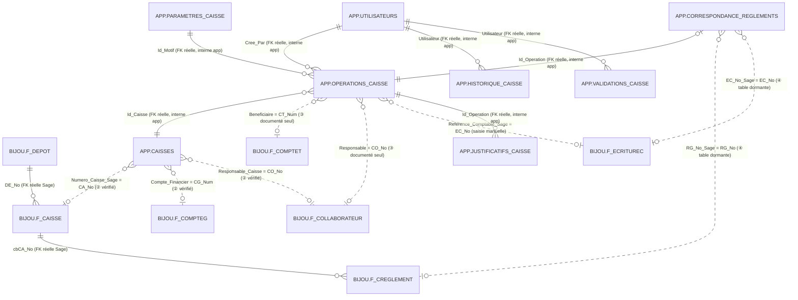
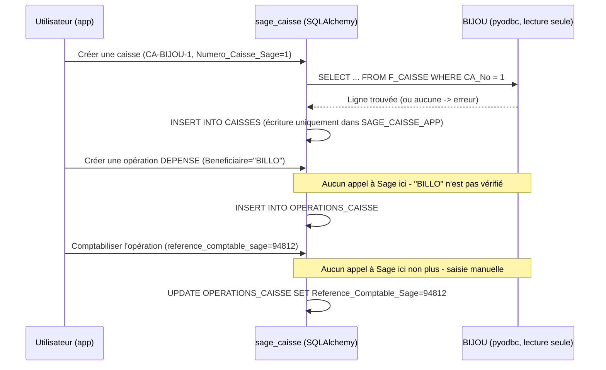

# Rapport — Correspondance entre SAGE_CAISSE_APP et BIJOU (Sage 100)

> Rapport pédagogique, rédigé à partir d'une analyse réelle du code (`modeles/`, `services/`, `objets_metier/`, `connexion/`, `config/`), du script de création de base (`04_SCHEMA_SAGE_CAISSE.sql`) et d'une vérification en direct de la base Sage `BIJOU` (connexion testée, structures et compteurs de lignes relus le 2026-11-08 via le compte `BIJOU_READONLY`, aucune donnée modifiée). Chaque affirmation ci-dessous est sourcée : soit par une ligne de code précise, soit par une requête réellement exécutée. Quand une correspondance n'est **pas** vérifiable dans le code (seulement documentée en commentaire), c'est signalé explicitement — ce rapport ne suppose jamais un lien qui ne serait qu'une intuition.

---

## 1. Vue d'ensemble : deux bases, deux rôles très différents

Le projet `sage_caisse` utilise **deux bases SQL Server distinctes**, situées sur le **même serveur physique** (`DESKTOP-6BAJCDP\SAGE`, confirmé par la connexion réelle), mais jamais mélangées :

|                             | **BIJOU**                                                                                                                                                | **SAGE_CAISSE_APP**                                                                                                       |
| --------------------------- | -------------------------------------------------------------------------------------------------------------------------------------------------------------- | ------------------------------------------------------------------------------------------------------------------------------- |
| Rôle                       | Base réelle de **Sage 100** (comptabilité/gestion commerciale du client)                                                                               | Base **propre à l'application** `sage_caisse`                                                                          |
| Accès depuis le code       | **Lecture seule**, forcée en dur dans le code (`ConnexionSageLectureSeule.executer_lecture` refuse toute requête qui ne commence pas par `SELECT`) | Lecture **et** écriture (seule base où ce projet écrit)                                                                |
| Technologie de connexion    | `pyodbc` brut, connexion directe par chaîne ODBC                                                                                                            | `SQLAlchemy` (moteur + sessions), modèles déclaratifs dans `modeles/`                                                     |
| Qui la gère                | **Sage** (et son éditeur) — ce projet n'y touche jamais                                                                                                | **Ce projet** — créée par le script `00_analyse/04_SCHEMA_SAGE_CAISSE.sql`, validé et exécuté le 2026-11-06       |
| Contenu pertinent pour nous | Tables `F_*` : caisses, tiers, comptes, journaux, écritures, règlements Sage                                                                               | 8 tables applicatives : utilisateurs, caisses, opérations, justificatifs, historique, validations, paramètres, correspondance |

**Image simple** : `BIJOU` est un **annuaire de référence qu'on consulte parfois** (pour vérifier qu'un numéro de caisse, un compte ou un collaborateur existe bien côté Sage) ; `SAGE_CAISSE_APP` est le **vrai cahier où l'application écrit** toutes les opérations de caisse. Il n'y a **aucune clé étrangère physique** entre les deux bases (techniquement, SQL Server n'autorise pas de contrainte `FOREIGN KEY` native entre deux bases différentes — seulement à l'intérieur d'une même base) : toute correspondance est soit une simple colonne documentée, soit une vérification faite **par le code Python**, jamais par le moteur SQL lui-même.

C'est exactement le mode **« autonome »** décrit dans le cahier des charges du projet (`prompt.txt`) : l'application fonctionne et calcule ses soldes seule, Sage n'étant consulté qu'en lecture, par opposition à un futur **« mode intégré »** (non activé) où les opérations seraient réellement écrites dans Sage via un mécanisme officiel.

---

## 2. Tableau de correspondance — table par table

| Table `SAGE_CAISSE_APP`     | Colonne(s) concernée(s)     | Table `BIJOU`     | Colonne Sage | Type de lien                                                                                                                         | Vérifié réellement où ?                                                                                           |
| ----------------------------- | ---------------------------- | ------------------- | ------------ | ------------------------------------------------------------------------------------------------------------------------------------ | --------------------------------------------------------------------------------------------------------------------- |
| `CAISSES`                   | `Numero_Caisse_Sage`       | `F_CAISSE`        | `CA_No`    | **Validé au moment de la création**, mais seulement si l'appelant fournit une connexion Sage                                 | `services/service_caisses.py` ligne 68 (`lecture_sage.lire_caisse_sage`)                                          |
| `CAISSES`                   | `Compte_Financier`         | `F_COMPTEG`       | `CG_Num`   | **Validé à la création**, même condition                                                                                   | `services/service_caisses.py` ligne 70 (`lire_compte_general_sage`)                                               |
| `CAISSES`                   | `Responsable_Caisse`       | `F_COLLABORATEUR` | `CO_No`    | **Validé à la création**, même condition                                                                                   | `services/service_caisses.py` ligne 72 (`lire_collaborateur_sage`)                                                |
| `OPERATIONS_CAISSE`         | `Beneficiaire`             | `F_COMPTET`       | `CT_Num`   | **Documenté seulement** (commentaire dans le schéma) — **aucune vérification réelle dans le code actuel**           | Commentaire dans `04_SCHEMA_SAGE_CAISSE.sql` ligne 85 ; `service_operations.py` n'appelle jamais `lecture_sage` |
| `OPERATIONS_CAISSE`         | `Responsable`              | `F_COLLABORATEUR` | `CO_No`    | **Documenté seulement**, non vérifié                                                                                        | idem                                                                                                                  |
| `OPERATIONS_CAISSE`         | `Compte_Financier`         | `F_COMPTEG`       | `CG_Num`   | **Documenté seulement**, non vérifié                                                                                        | idem                                                                                                                  |
| `OPERATIONS_CAISSE`         | `Reference_Comptable_Sage` | `F_ECRITUREC`     | `EC_No`    | **Saisi manuellement** par un MANAGER lors de la comptabilisation — jamais lu ni vérifié dans Sage                          | `services/service_operations.py` ligne 556 (`comptabiliser_operation`)                                            |
| `CORRESPONDANCE_REGLEMENTS` | `RG_No_Sage`               | `F_CREGLEMENT`    | `RG_No`    | **Prévu pour un futur « mode intégré »** — la table existe en base mais **aucun service ne l'utilise aujourd'hui** | `modeles/correspondance.py` — jamais importé dans `services/`                                                   |
| `CORRESPONDANCE_REGLEMENTS` | `EC_No_Sage`               | `F_ECRITUREC`     | `EC_No`    | idem — **non exploité**                                                                                                      | idem                                                                                                                  |
| `UTILISATEURS`              | —                           | *(aucune)*        | —           | Aucune correspondance Sage : table 100 % applicative (comptes de connexion, pas liée à `F_COLLABORATEUR`)                        | —                                                                                                                    |
| `PARAMETRES_CAISSE`         | —                           | *(aucune)*        | —           | Aucune correspondance Sage (motifs internes, indépendants de `N_Reglement` côté Sage)                                           | —                                                                                                                    |
| `JUSTIFICATIFS_CAISSE`      | —                           | *(aucune)*        | —           | Aucune correspondance Sage (fichiers stockés sur disque + ligne en base)                                                            | —                                                                                                                    |
| `VALIDATIONS_CAISSE`        | —                           | *(aucune)*        | —           | Aucune correspondance Sage (journal des actions de workflow interne)                                                                 | —                                                                                                                    |
| `HISTORIQUE_CAISSE`         | —                           | *(aucune)*        | —           | Aucune correspondance Sage (traçabilité champ par champ, interne)                                                                  | —                                                                                                                    |

**Point important à bien comprendre** : la colonne `Numero_Caisse_Sage` de `CAISSES` n'est **pas une clé étrangère SQL**. C'est un entier ordinaire. Rien n'empêche techniquement SQL Server d'y accepter n'importe quelle valeur. C'est **le code Python** (`service_caisses.creer_caisse`) qui, *si* on lui fournit une connexion Sage active, va lire `F_CAISSE` pour vérifier que la valeur existe réellement **avant** d'accepter l'écriture. Si aucune connexion Sage n'est fournie (cas des tests, ou d'un usage sans Sage disponible), la valeur est acceptée **sans aucune vérification**.

---

## 3. Explication simple, relation par relation

### 3.1 `CAISSES` ↔ `F_CAISSE` (la plus solide des correspondances)

Une caisse applicative (ex. *"Caisse Bijou SA"*) peut optionnellement pointer vers une vraie caisse Sage (`CA_No`). Quand on crée la caisse **avec** une connexion Sage fournie, le code va chercher `CA_No` dans `F_CAISSE` ; s'il n'existe pas, la création est refusée avec une erreur explicite (`"La caisse Sage {numero} n'existe pas"`). Sinon, le numéro Sage est simplement recopié tel quel dans la colonne `Numero_Caisse_Sage`.

**Donnée réelle vérifiée aujourd'hui dans `BIJOU`** : `F_CAISSE` contient **4 lignes** (ex. `CA_No=1`, *"Caisse 1 Bijou SA"*).

### 3.2 `CAISSES.Compte_Financier` ↔ `F_COMPTEG.CG_Num`

Même principe : si fourni, le compte comptable (ex. `5310` = *"Caisse en euro"*, un des 313 comptes de `F_COMPTEG` selon la Phase 2) est vérifié avant acceptation.

### 3.3 `CAISSES.Responsable_Caisse` ↔ `F_COLLABORATEUR.CO_No`

Idem pour le responsable de caisse. **Donnée réelle** : `F_COLLABORATEUR` contient **11 lignes**, dont **3 collaborateurs flagués `CO_Caissier = 1`** (donc réellement caissiers côté Sage).

### 3.4 `OPERATIONS_CAISSE` — des références Sage **non vérifiées**

C'est le point le plus important à retenir de ce rapport : contrairement aux caisses, **aucune opération de caisse (`OPERATIONS_CAISSE`) ne fait l'objet d'une vérification réelle contre Sage**, que ce soit pour le bénéficiaire (`Beneficiaire`, censé correspondre à `F_COMPTET.CT_Num`), le responsable, ou le compte financier/analytique. Ces colonnes sont du texte/entier libre : la correspondance n'existe que dans la documentation (commentaires du schéma SQL), pas dans le comportement réel du programme. Si un utilisateur tape un code bénéficiaire qui n'existe pas dans `F_COMPTET`, l'opération est créée sans erreur.

### 3.5 `OPERATIONS_CAISSE.Reference_Comptable_Sage` ↔ `F_ECRITUREC.EC_No`

Quand une opération passe au statut `COMPTABILISE`, un MANAGER peut (optionnellement) saisir un numéro d'écriture Sage (`reference_comptable_sage`). Ce numéro est **stocké tel quel**, sans jamais être relu dans `F_ECRITUREC` pour confirmer qu'il existe. C'est un champ **informatif**, pas un lien vérifié.

### 3.6 `CORRESPONDANCE_REGLEMENTS` — une table prête, mais dormante

Cette table a été conçue dès la Phase 3 pour préparer un futur **mode intégré Sage** : elle pourrait un jour relier une opération applicative à un vrai règlement Sage (`F_CREGLEMENT.RG_No`) et à une vraie écriture (`F_ECRITUREC.EC_No`). Aujourd'hui, **elle existe en base (créée, vide) mais aucun service Python ne la lit ni ne l'écrit** — c'est une fondation posée à l'avance, explicitement documentée comme « non exploitée avant qu'un mode intégré Sage ne soit explicitement étudié et autorisé ».

### 3.7 Les 5 tables 100 % applicatives

`UTILISATEURS`, `PARAMETRES_CAISSE`, `JUSTIFICATIFS_CAISSE`, `VALIDATIONS_CAISSE`, `HISTORIQUE_CAISSE` n'ont **aucune colonne, aucune logique, aucune mention** renvoyant vers Sage. Elles concernent uniquement le fonctionnement interne de l'application (comptes de connexion, motifs de dépense, pièces jointes, journal des validations, journal des modifications).

---

## 4. Relations **directes** vs **indirectes** vs **documentées seulement**

Pour éviter toute ambiguïté, voici les trois niveaux de preuve trouvés dans ce projet :

```SQL
flowchart TB
    subgraph Legende["Niveaux de correspondance trouvés"]
        direction LR
        A["① Contrainte FK réelle<br/>(SQL Server l'impose)"]
        B["② Vérifiée par le code Python<br/>(avant écriture)"]
        C["③ Documentée seulement<br/>(commentaire, non codée)"]
        D["④ Table prête, non utilisée<br/>(mode intégré futur)"]
    end
```

- **① Contrainte FK réelle, mais uniquement à l'intérieur de BIJOU elle-même** (pas entre les deux bases) :
  `F_CREGLEMENT.cbCA_No → F_CAISSE.CA_No` (contrainte `FKA_F_CREGLEMENT_CA_No`, vérifiée en direct aujourd'hui) et `F_CAISSE.DE_No → F_DEPOT.DE_No` (`FKA_F_CAISSE_DE_No`). Ces liens existent **dans Sage**, indépendamment de notre application.
- **② Vérifiée par le code Python** : `CAISSES.Numero_Caisse_Sage/Compte_Financier/Responsable_Caisse` → section 3.1-3.3 ci-dessus. C'est le niveau le plus solide **côté application**.
- **③ Documentée seulement** : `OPERATIONS_CAISSE.Beneficiaire/Responsable/Compte_Financier` → section 3.4.
- **④ Table prête, non utilisée** : `CORRESPONDANCE_REGLEMENTS` → section 3.6.

**Relation indirecte intéressante** : une opération (`OPERATIONS_CAISSE`) est liée à sa caisse applicative par une vraie FK interne (`OPERATIONS_CAISSE.Id_Caisse → CAISSES.Id_Caisse`), et cette caisse peut elle-même être liée à `F_CAISSE.CA_No` (niveau ②). Donc une opération **n'est jamais reliée directement à Sage** : elle l'est, au mieux, **indirectement**, via sa caisse. Et comme `F_CREGLEMENT.cbCA_No → F_CAISSE.CA_No` existe réellement côté Sage (①), si un jour le mode intégré écrivait un vrai règlement, il retomberait naturellement sur la même caisse Sage que celle déjà référencée par `CAISSES.Numero_Caisse_Sage` — cohérent, mais **non automatisé aujourd'hui**.

---

## 5. Schéma relationnel global



*(Trait plein `||--o{` = contrainte FK réelle vérifiée en base. Trait pointillé `}o..o|` = correspondance applicative ou documentaire, sans contrainte SQL.)*

### Flux d'écriture/lecture réel



**Ce schéma résume la réalité du code** : Sage n'est **jamais écrit**, et n'est **lu** que dans un seul cas précis (création d'une caisse, et seulement si une connexion Sage est explicitement fournie à la fonction). Tout le reste de l'activité (opérations, justificatifs, workflow, historique) se déroule **exclusivement** dans `SAGE_CAISSE_APP`.

---

## 6. Tables Sage examinées sans correspondance applicative directe

Ces tables de `BIJOU` ont été étudiées (Phase 1/2) car pertinentes pour comprendre le fonctionnement de la caisse côté Sage, mais **aucune colonne de `SAGE_CAISSE_APP` ne les référence** aujourd'hui :

| Table Sage        | Lignes réelles (vérifiées)         | Pourquoi elle a été regardée                                                                                                                                                                                                        |
| ----------------- | ------------------------------------- | -------------------------------------------------------------------------------------------------------------------------------------------------------------------------------------------------------------------------------------- |
| `F_JOURNAUX`    | 18                                    | Comprendre le journal `CAIS` (caisse), utile seulement si le mode intégré est activé un jour                                                                                                                                      |
| `F_ECRITUREC`   | 561 (dont 12 sur le journal `CAIS`) | Montre que des mouvements de caisse existent **déjà** dans Sage, saisis directement en écriture comptable — **avant même l'existence de ce projet** — mais ce ne sont pas des lignes que l'application lit ou écrit |
| `F_REGLECH`     | 0                                     | Échéances liées à un règlement — vide, lié à `F_CREGLEMENT` par FK réelle côté Sage, sans lien avec notre application                                                                                                     |
| `F_CAISSETOTAL` | 0                                     | Totalisation de caisse Sage — vide, non exploitée                                                                                                                                                                                    |

**Constat clé (déjà établi en Phase 2, reconfirmé aujourd'hui)** : `F_CREGLEMENT`, la table Sage normalement destinée aux règlements, est **vide (0 ligne)** dans `BIJOU`. Les seuls mouvements de caisse réels présents côté Sage se trouvent dans `F_ECRITUREC` (saisie comptable directe), pas dans `F_CREGLEMENT`. Cela n'a aucun impact sur le fonctionnement actuel de l'application (mode autonome), mais explique pourquoi `CORRESPONDANCE_REGLEMENTS.RG_No_Sage` n'a, pour l'instant, **rien à pointer**.

---

## 7. Comment les données circulent réellement, en résumé

1. **L'application n'a besoin de Sage que pour deux choses** : (a) vérifier, au moment de créer une caisse, que les références Sage fournies existent réellement (`F_CAISSE`, `F_COMPTEG`, `F_COLLABORATEUR`) ; (b) permettre, un jour, de retrouver l'historique des mouvements de caisse déjà saisis dans Sage avant l'application (`F_ECRITUREC`, journal `CAIS`).
2. **Tout le reste vit uniquement dans `SAGE_CAISSE_APP`** : création, modification, workflow (brouillon → validé → comptabilisé → annulé), calcul du solde, historique, justificatifs. Rien de tout cela n'est écrit dans Sage.
3. **Il n'existe aucune automatisation qui pousse une opération validée vers Sage.** `Reference_Comptable_Sage` et `CORRESPONDANCE_REGLEMENTS` sont des **fondations posées pour plus tard**, pas des mécanismes actifs.
4. **La séparation est délibérée et documentée** (`prompt.txt`, section « Distinction importante ») : le mode autonome a été choisi explicitement pour pouvoir tester toute la gestion des dépenses sans risquer de modifier la comptabilité Sage. Un futur « mode intégré » (écriture réelle dans Sage) est évoqué mais **non implémenté**, et devrait obligatoirement passer par un mécanisme officiellement supporté par Sage — jamais par un `INSERT`/`UPDATE` SQL direct sur `F_CREGLEMENT` ou toute autre table `F_*`.

---

## 8. Sources

- Code : `modeles/*.py`, `services/service_caisses.py`, `services/service_operations.py`, `objets_metier/lecture_sage.py`, `connexion/connexion_sage_lecture.py`, `connexion/connexion_app.py`, `config/configuration.py`.
- Schéma applicatif : `00_analyse/04_SCHEMA_SAGE_CAISSE.sql`, `00_analyse/04_PHASE3_SCHEMA_APPLICATIF.md`.
- Analyse fonctionnelle Sage : `00_analyse/02_DICTIONNAIRE_FONCTIONNEL_CAISSE.md` (Phase 2, données vérifiées le 2026-11-06).
- Vérification en direct de `BIJOU` (ce rapport, 2026-11-08) : connexion testée (`DESKTOP-6BAJCDP\SAGE`), compteurs de lignes relus (`F_CREGLEMENT`=0, `F_CAISSE`=4, `F_COMPTET`=68, `F_COLLABORATEUR`=11, `F_JOURNAUX`=18, `F_ECRITUREC`=561, `F_REGLECH`=0, `F_CAISSETOTAL`=0), clés étrangères réelles relues (`FKA_F_CREGLEMENT_CA_No`, `FKA_F_CAISSE_DE_No`). Aucune écriture effectuée.
